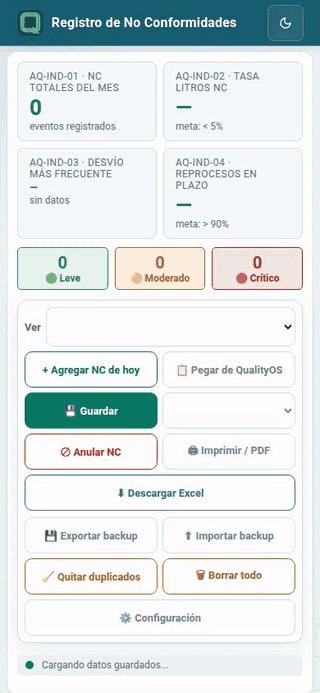
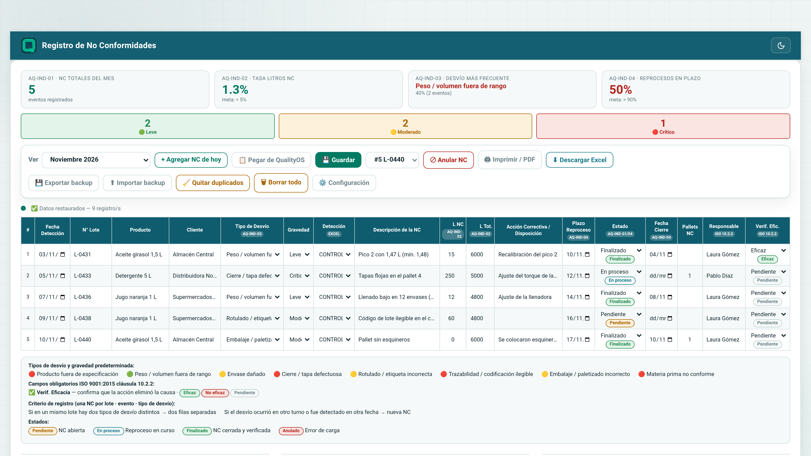
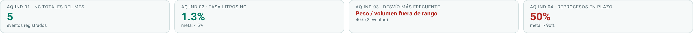
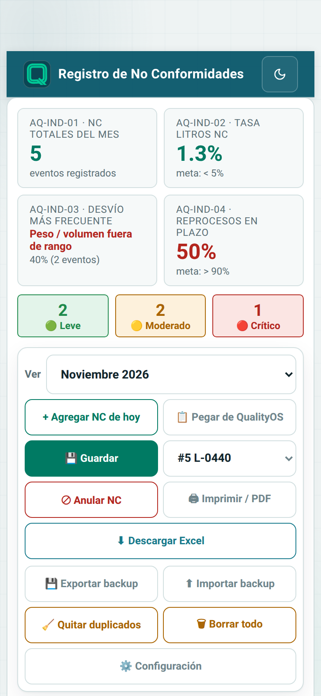
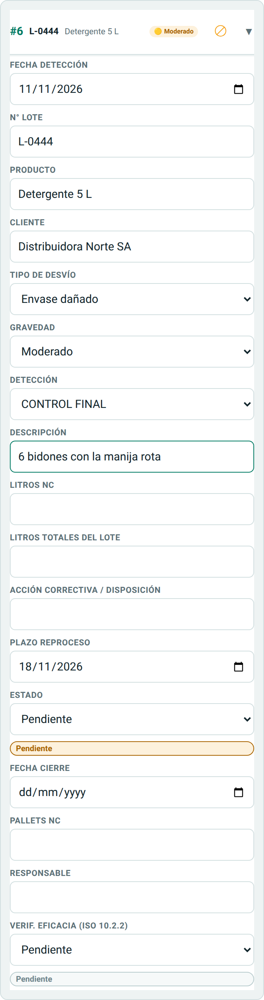
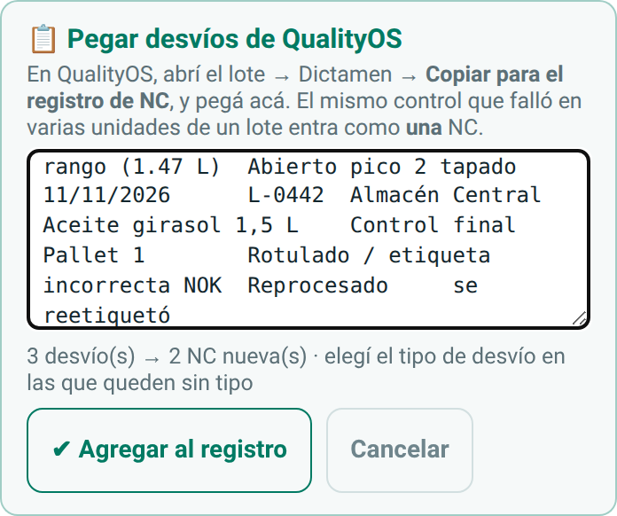
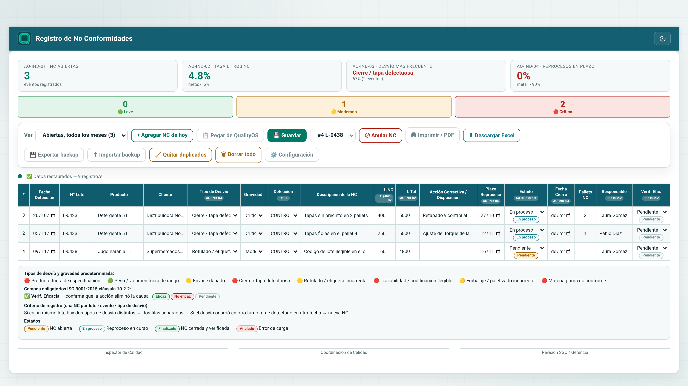
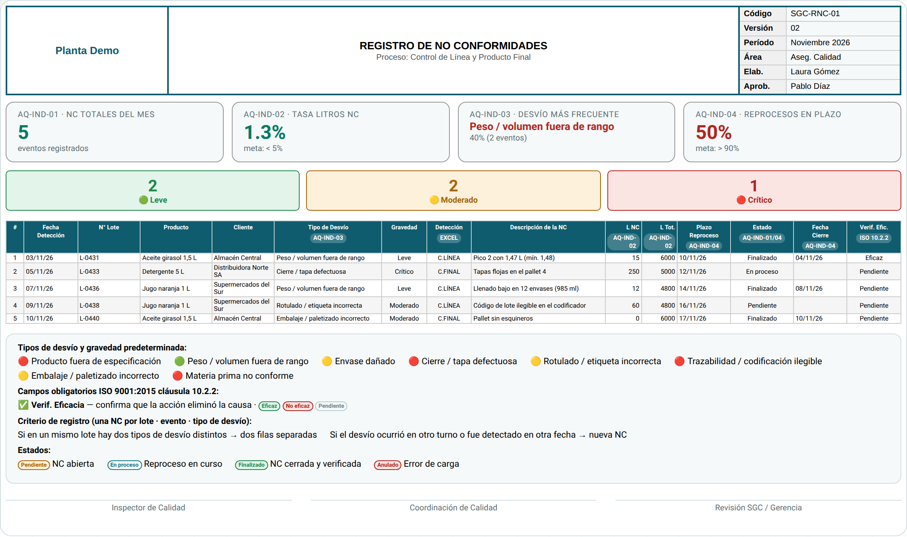
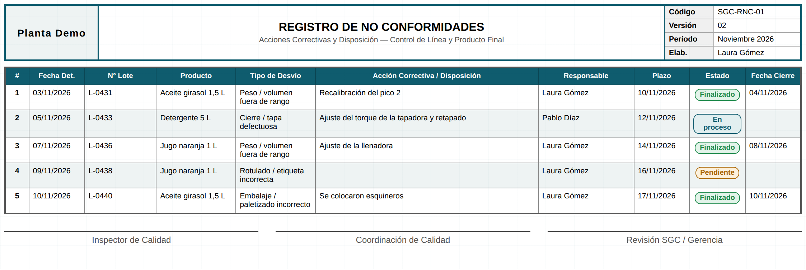
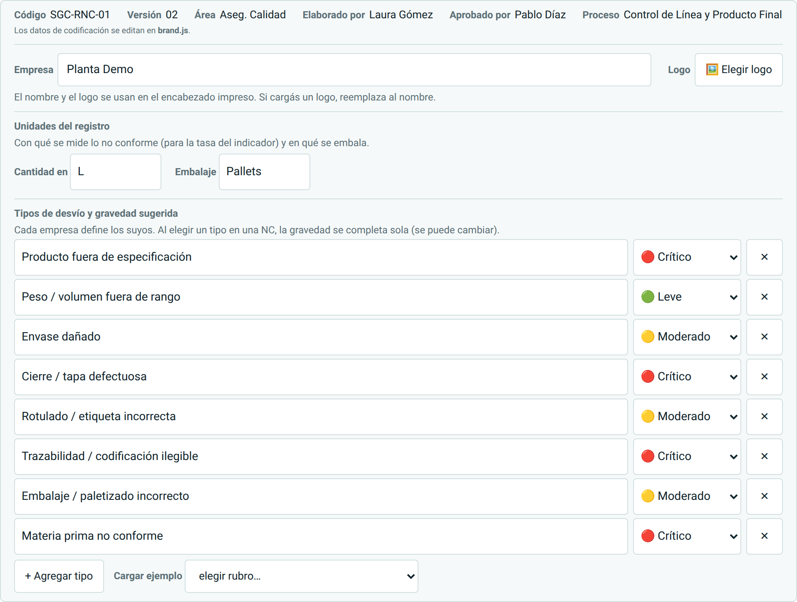

# Guía de uso · Registro de No Conformidades

Paso a paso para quien la usa por primera vez. Las capturas son de una empresa de ejemplo
("Planta Demo") con datos inventados.

> También hay un [video de 1 minuto y medio](video/calidad-no-conformidades-demo.mp4) con todo el recorrido.

**Contenido**

1. [Abrirla e instalarla](#1-abrirla-e-instalarla)
2. [El registro del mes](#2-el-registro-del-mes)
3. [Cargar la NC del día](#3-cargar-la-nc-del-día)
4. [Pegar desvíos de QualityOS](#4-pegar-desvíos-de-qualityos)
5. [Seguimiento: las abiertas](#5-seguimiento-las-abiertas)
6. [Entregar el mes: imprimir y Excel](#6-entregar-el-mes-imprimir-y-excel)
7. [Configuración](#7-configuración)
8. [Tus datos, sin señal y respaldo](#8-tus-datos-sin-señal-y-respaldo)
9. [Preguntas frecuentes](#9-preguntas-frecuentes)

---

## 1. Abrirla e instalarla

Abrí **https://roca-byte.github.io/calidad-no-conformidades/**. No hace falta cuenta.

Para tenerla como una app: en **Android (Chrome)**, menú ⋮ → *Instalar app*; en **iPhone
(Safari)**, Compartir → *Agregar a inicio*; en la **compu (Chrome o Edge)**, el ícono de
instalar en la barra de direcciones. Después de abrirla una vez, funciona sin señal.

## 2. El registro del mes

Arriba están los **indicadores** del mes que estás viendo, y abajo la planilla con una fila por NC.

| Indicador | Qué mide |
|---|---|
| **AQ-IND-01 · NC totales del mes** | Cuántas NC hay en el mes (las anuladas no cuentan) |
| **AQ-IND-02 · Tasa litros NC** | Litros no conformes sobre litros totales de los lotes. Meta: menos de 5 % |
| **AQ-IND-03 · Desvío más frecuente** | El tipo de desvío que más se repite y qué porcentaje es |
| **AQ-IND-04 · Reprocesos en plazo** | De las NC con litros afectados y plazo, cuántas se finalizaron a tiempo. Meta: más de 90 % |

Abajo, la cantidad de NC **Leves**, **Moderadas** y **Críticas**. Si tu planta no mide en
litros, la tasa usa la unidad que elijas (ver [Configuración](#7-configuración)).

## 3. Cargar la NC del día

La idea es cargar cada NC **el día que aparece**, no todo a fin de mes. En el celular cada NC
es una tarjeta (la última arriba); en la compu, una fila.

 

1. Tocá **+ Agregar NC de hoy**: la NC trae la **fecha de hoy** y el **plazo** (5 días hábiles).
2. Completá lote, producto, **cliente**, tipo de desvío, detección y descripción.
3. El **tipo de desvío** completa la **gravedad** sugerida (se puede cambiar).
4. Si sabés los litros afectados y los del lote, cargalos: alimentan la tasa del indicador.

**Se guarda sola** a medida que escribís (abajo de la barra dice *Guardado*). El plazo se
recalcula si cambiás la fecha, salvo que lo hayas puesto a mano. Si le cambiás la fecha a otro
mes, la NC pasa a ese mes.

Para sacar una NC cargada por error, elegila en el selector de la barra y tocá **⊘ Anular NC**
(o el ⊘ de su tarjeta): queda en el registro como **Anulado** y no cuenta en los indicadores.

## 4. Pegar desvíos de QualityOS

Si además usás [QualityOS](https://github.com/roca-byte/qualityos), no hace falta tipear: en el
lote, **Dictamen → Copiar para el registro de NC**, y acá **📋 Pegar de QualityOS**.

- El **mismo control que falló en varias unidades** de un lote entra como **una** NC, con las
  unidades en la descripción.
- Lo que se **corrigió en el momento** (reprocesado) entra **Finalizado**.
- Si el nombre del control coincide con uno de tus tipos de desvío, lo toma.
- **Pegar dos veces no duplica**.

Sin QualityOS la app funciona igual: esto es solo un atajo.

## 5. Seguimiento: las abiertas

En **Ver** elegí **Abiertas, todos los meses**: junta las NC **Pendientes** y **En proceso** de
este mes y de los anteriores. Es la vista para el día a día.

Cuando la acción se completa: cargá la **fecha de cierre**, la **verificación de eficacia**
(Eficaz / No eficaz, ISO 9001 10.2.2) y pasá el estado a **Finalizado**. Al finalizarla sale de
las abiertas y sigue en el registro de su mes.

| Estado | Qué significa |
|---|---|
| **Pendiente** | NC abierta |
| **En proceso** | Reproceso o acción en curso |
| **Finalizado** | NC cerrada y verificada |
| **Anulado** | Error de carga (no cuenta) |

## 6. Entregar el mes: imprimir y Excel

En **Ver** elegí el mes. Cada NC pertenece al mes de su **fecha de detección**, así que **no
hace falta borrar nada** para empezar el mes siguiente.

- **🖨 Imprimir / PDF**: A4 apaisado en dos hojas. La primera, el registro con los
  indicadores y la codificación; la segunda, las acciones correctivas, responsables, plazos y
  cierres, con lugar para las firmas. En el diálogo de impresión elegí *Guardar como PDF*.
- **⬇ Descargar Excel**: las NC del mes (incluidas las anuladas, con su estado).

## 7. Configuración

Tocá **⚙️ Configuración**.

- **Empresa y logo**: salen en el encabezado impreso. Si cargás un logo, reemplaza al nombre.
- **Unidades del registro**: con qué se mide lo no conforme (**L**, kg, unidades…) y en qué
  se embala (**Pallets**, cajas…). Cambian las columnas, el indicador de la tasa y el Excel.
- **Tipos de desvío** con su **gravedad sugerida**: agregá, renombrá o quitá los tuyos, o cargá
  un **ejemplo por rubro** (general, alimentos y bebidas, agroquímicos, cosmética). Las NC ya
  cargadas conservan su tipo aunque lo saques de la lista.
- La **codificación** del registro (código, versión, área, elaboró, aprobó) se define en
  `brand.js` (ver [DESARROLLO.md](../DESARROLLO.md)).

## 8. Tus datos, sin señal y respaldo

- Todo queda **solo en tu equipo** (el navegador). No hay cuentas ni servidor, y funciona **sin
  señal**.
- Por eso, si borrás los datos del navegador o cambiás de equipo, **se pierden**. Hacé
  **💾 Exportar backup** seguido (por ejemplo, cada semana y a fin de mes) y guardá el archivo.
  **⬆ Importar backup** lo recupera, en ese u otro equipo.
- **🧹 Quitar duplicados** busca NC cargadas dos veces iguales y deja una.
- **🗑 Borrar todo** borra **todas** las NC de todos los meses (pide confirmar dos veces).

## 9. Preguntas frecuentes

**¿La pueden usar varias personas a la vez?**
No: cada equipo tiene su propio registro. Para un registro compartido por todo el equipo de
Calidad, con varios equipos sincronizados, está [QualityOS](https://github.com/roca-byte/qualityos).

**¿Puedo pasar mis NC a QualityOS después?**
Sí: QualityOS importa el backup de esta app (pestaña NC → *Importar del registro individual*).

**¿Se puede editar una NC de un mes anterior?**
Sí: elegí ese mes en **Ver** (o **Abiertas**, si sigue abierta) y editala.

**No veo una NC que cargué.**
Fijate el mes en **Ver**: la NC está en el mes de su fecha de detección. Si no tiene fecha,
aparece en el mes actual.
